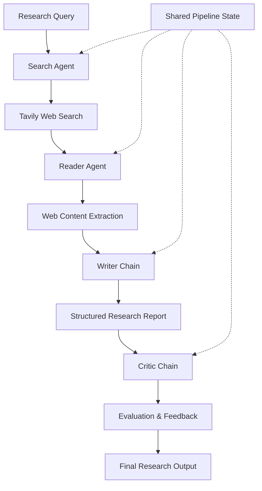

 
<div align="center">

# DEEPSCOPE

### Multi-Agent AI Research System

**From web search to structured research reports — automated through intelligent AI agents.**

<br/>

[](https://www.python.org/)
[](https://www.langchain.com/)
[](https://ai.google.dev/)
[](https://tavily.com/)
[](LICENSE)

<br/>

[Overview](#overview) · [Architecture](#system-architecture) · [Agents](#intelligent-agents) · [Tech Stack](#technology-stack) · [Installation](#installation) · [Workflow](#how-it-works)

</div>

---

## Overview

**DEEPSCOPE** is a multi-agent research automation system built with Python and LangChain. It uses specialized AI agents and processing chains to transform a research query into a structured, evaluated report.

Instead of relying on a single LLM response, the system divides research into focused stages. Each stage performs a specific responsibility, allowing the complete pipeline to search the web, extract relevant information, generate a report, and evaluate the final output.

Powered by **Google Gemini**, **Tavily Search**, and web-content extraction tools, NEXUS AI brings multiple AI capabilities together in one coordinated research workflow.

### What makes it different?

- **Agent-based execution:** Specialized agents handle different research responsibilities.
- **Live web research:** Retrieves relevant information using Tavily.
- **Content extraction:** Reads and extracts useful information from web pages.
- **Structured generation:** Converts collected information into organized research reports.
- **Automated evaluation:** A critic chain reviews the generated report.
- **Shared pipeline state:** Passes research information between stages.
- **Modular architecture:** Individual components can be maintained and extended independently.

---
## Workflow Diagram
<hr>
<div align="center">
  
</div>
<hr>
## System Architecture

The system follows a sequential multi-agent pipeline where each stage contributes to the final research output.



### Pipeline components

| Stage | Responsibility |
|---|---|
| Research Query | Accepts the user's research topic |
| Search Agent | Finds relevant information from the web |
| Reader Agent | Extracts and processes web-page content |
| Writer Chain | Generates a structured research report |
| Critic Chain | Reviews and evaluates the generated report |
| Final Output | Delivers the processed research result |

---

## Intelligent Agents

### 01. Search Agent

Responsible for discovering relevant information from the web.

- Uses Tavily for web search.
- Searches for information related to the research query.
- Collects relevant URLs and search results.
- Supplies research sources to the next stage.

### 02. Reader Agent

Responsible for reading and extracting useful information from discovered sources.

- Processes URLs collected by the Search Agent.
- Uses Requests and BeautifulSoup for web-page extraction.
- Extracts relevant textual content.
- Prepares information for report generation.

### 03. Writer Chain

Transforms extracted research material into a structured report.

- Processes information gathered by the previous agents.
- Uses an LLM-powered generation chain.
- Organizes information into a readable format.
- Produces a research report based on collected sources.

### 04. Critic Chain

Evaluates the report generated by the Writer Chain.

- Reviews the generated content.
- Evaluates the quality and relevance of the report.
- Provides feedback on the generated result.
- Adds an evaluation stage to the research pipeline.

---

## How It Works

The complete execution follows a coordinated workflow:

1. **Input:** A research topic is provided to the system.
2. **Search:** The Search Agent uses Tavily to discover relevant web sources.
3. **Read:** The Reader Agent extracts information from the collected URLs.
4. **Write:** The Writer Chain processes the extracted content and generates a structured report.
5. **Critique:** The Critic Chain evaluates the generated report and provides feedback.
6. **Output:** The pipeline delivers the research result.

Each stage receives information from the preceding stage through a shared pipeline state, keeping the workflow organized and modular.

---

## Technology Stack

| Technology | Purpose |
|---|---|
| Python | Core programming language |
| LangChain | Agent orchestration and LLM workflows |
| LangChain Expression Language (LCEL) | Composable processing chains |
| Google Gemini | Language model for research and generation |
| Tavily | Web search and information discovery |
| BeautifulSoup | HTML parsing and content extraction |
| Requests | HTTP requests and web-page retrieval |
| Python-dotenv | Environment variable management |
| Pydantic | Data validation and structured models |
| Rich | Enhanced terminal output |
| Streamlit | UI exploration in the project workflow |

---

## Project Structure

```text
nexus-ai-research/
│
├── agents.py              # Search and Reader agents, Writer and Critic chains
├── tools.py               # Tavily search and web scraping tools
├── pipeline.py            # Main multi-agent execution pipeline
│
├── requirements.txt       # Python dependencies
├── .env                   # API keys and environment variables
├── .gitignore             # Ignored files and directories
└── README.md              # Project documentation
```

---

## Installation & Setup

### 1. Clone the repository

```bash
git clone https://github.com/BlockNotes-4515/nexus-ai-research.git
cd nexus-ai-research
```

### 2. Create a virtual environment

```bash
python -m venv .venv
```

Activate it:

**Windows PowerShell**
```powershell
.\.venv\Scripts\Activate.ps1
```

**Linux / macOS**
```bash
source .venv/bin/activate
```

### 3. Install dependencies

```bash
pip install -r requirements.txt
```

### 4. Configure API keys

Create a `.env` file in the root directory:

```env
GOOGLE_API_KEY=your_google_gemini_api_key
TAVILY_API_KEY=your_tavily_api_key
```

Get your API keys:

- [Google AI Studio](https://aistudio.google.com/app/apikey)
- [Tavily](https://app.tavily.com/)

**Security:** Never commit your `.env` file or expose your API keys publicly.

### 5. Run the project

```bash
python pipeline.py
```

---

## Configuration

NEXUS AI uses Google Gemini as its language model provider.

The model can be configured in the agent initialization according to the models available to your API key.

Example:

```python
from langchain_google_genai import ChatGoogleGenerativeAI

llm = ChatGoogleGenerativeAI(
    model="gemini-3.8-flash",
    temperature=0
)
```

The system uses Tavily for web search and custom Python tools for extracting web-page content.

---

## Key Concepts Demonstrated

This project explores practical concepts in modern AI application development:

- Multi-agent AI architecture
- LLM integration with Google Gemini
- LangChain agent creation
- LangChain Expression Language (LCEL)
- Custom tool development
- Web search and information retrieval
- Web scraping and content extraction
- Prompt engineering
- Sequential pipeline orchestration
- Shared state management
- Automated content evaluation
- Environment-based API configuration

---

## Future Enhancements

Potential directions for extending the system:

- Interactive Streamlit research dashboard
- Source citations and reference tracking
- More specialized research agents
- Improved report-quality scoring
- Agent retry and error-handling mechanisms
- Parallel research execution
- Export reports to PDF and Markdown
- Research history and saved reports

---

## Learning Reference

This project was developed as a hands-on exploration of multi-agent AI systems and LangChain workflows.

**Tutorial reference:** [Multi-Agent AI Research System – YouTube](https://www.youtube.com/watch?v=P22qI2RnNjA)

The implementation explores the concepts of agent orchestration, custom tools, LLM-powered chains, and end-to-end research automation.

---

## Author

<div align="center">

**Dhruv Dhayal**

MCA Student · Software Engineer Aspirant · AI & Backend Development

[](https://github.com/BlockNotes-4515)
[](https://www.linkedin.com/in/dhruv-dhayal-9568b7262/)

**Building intelligent systems, one idea at a time.**

</div>

---

<div align="center">

If you find this project interesting, consider giving it a star.

**DEEPSCOPE — Research, orchestrated intelligently.**

</div>
