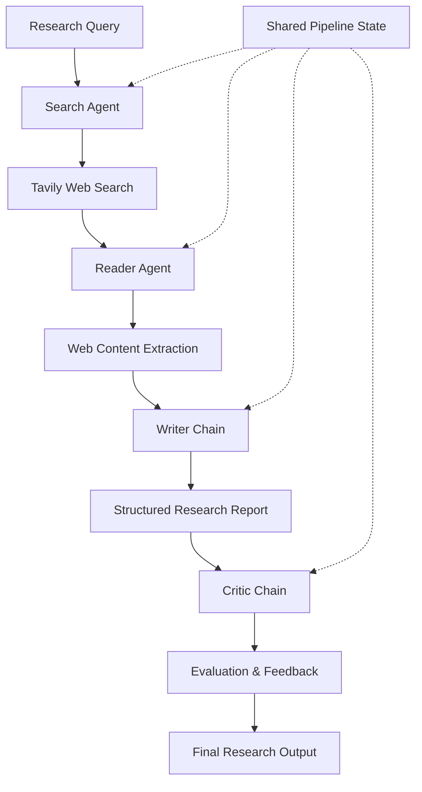

 

# DEEPSCOPE

### Multi-Agent AI Research System

**From web search to structured research reports — automated through intelligent AI agents.**

 

 

[Overview](#overview) · [Architecture](#system-architecture) · [Agents](#intelligent-agents) · [Tech Stack](#technology-stack) · [Installation](#installation) · [Workflow](#how-it-works)

---

## Overview

**NEXUS AI** is a multi-agent research automation system built with Python and LangChain. It uses specialized AI agents and processing chains to transform a research query into a structured, evaluated report.

Instead of relying on a single LLM response, the system divides research into focused stages. Each stage performs a specific responsibility, allowing the complete pipeline to search the web, extract relevant information, generate a report, and evaluate the final output.

Powered by **Google Gemini**, **Tavily Search**, and web-content extraction tools, NEXUS AI brings multiple AI capabilities together in one coordinated research workflow.

### What makes it different?

- **Agent-based execution:** Specialized agents handle different research responsibilities.
- **Live web research:** Retrieves relevant information using Tavily.
- **Content extraction:** Reads and extracts useful information from web pages.
- **Structured generation:** Converts collected information into organized research reports.
- **Automated evaluation:** A critic chain reviews the generated report.
- **Shared pipeline state:** Passes research information between stages.
- **Modular architecture:** Individual components can be maintained and extended independently.

---

## System Architecture

The system follows a sequential multi-agent pipeline where each stage contributes to the final research output.

### Pipeline components

| Stage | Responsibility |
|---|---|
| Research Query | Accepts the user's research topic |
| Search Agent | Finds relevant information from the web |
| Reader Agent | Extracts and processes web-page content |
| Writer Chain | Generates a structured research report |
| Critic Chain | Reviews and evaluates the generated report |
| Final Output | Delivers the processed research result |

---

## Intelligent Agents

### 01. Search Agent

Responsible for discovering relevant information from the web.

- Uses Tavily for web search.
- Searches for information related to the research query.
- Collects relevant URLs and search results.
- Supplies research sources to the next stage.

### 02. Reader Agent

Responsible for reading and extracting useful information from discovered sources.

- Processes URLs collected by the Search Agent.
- Uses Requests and BeautifulSoup for web-page extraction.
- Extracts relevant textual content.
- Prepares information for report generation.

### 03. Writer Chain

Transforms extracted research material into a structured report.

- Processes information gathered by the previous agents.
- Uses an LLM-powered generation chain.
- Organizes information into a readable format.
- Produces a research report based on collected sources.

### 04. Critic Chain

Evaluates the report generated by the Writer Chain.

- Reviews the generated content.
- Evaluates the quality and relevance of the report.
- Provides feedback on the generated result.
- Adds an evaluation stage to the research pipeline.

---

## How It Works

The complete execution follows a coordinated workflow:

1. **Input:** A research topic is provided to the system.
2. **Search:** The Search Agent uses Tavily to discover relevant web sources.
3. **Read:** The Reader Agent extracts information from the collected URLs.
4. **Write:** The Writer Chain processes the extracted content
